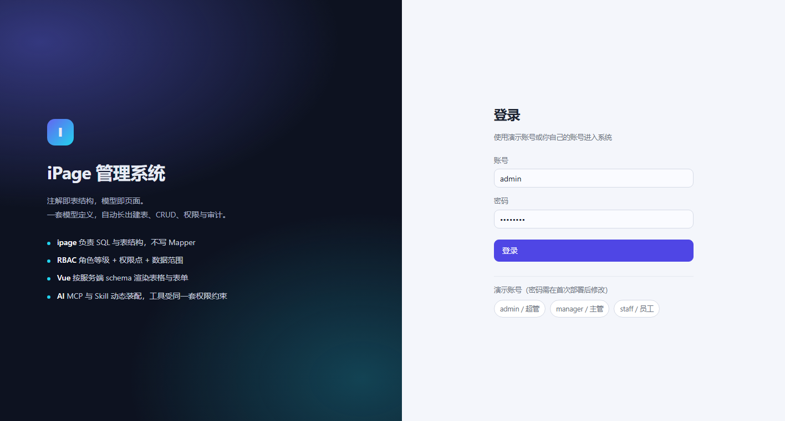
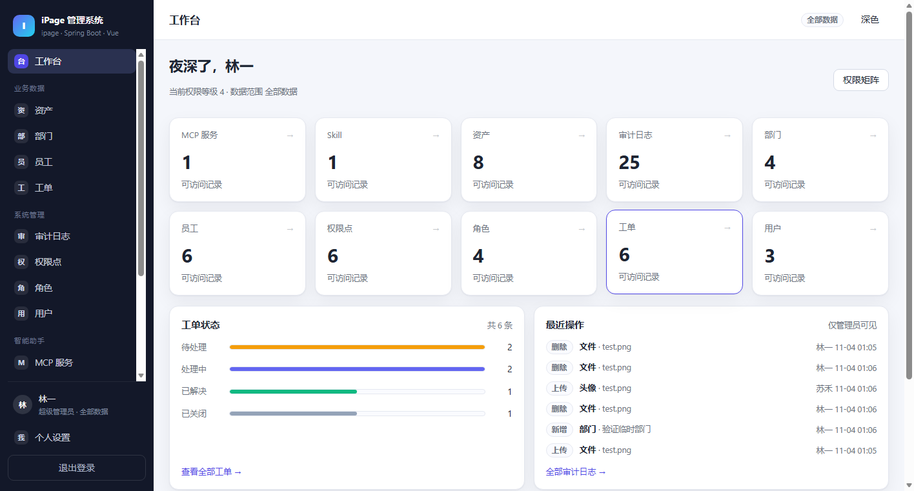
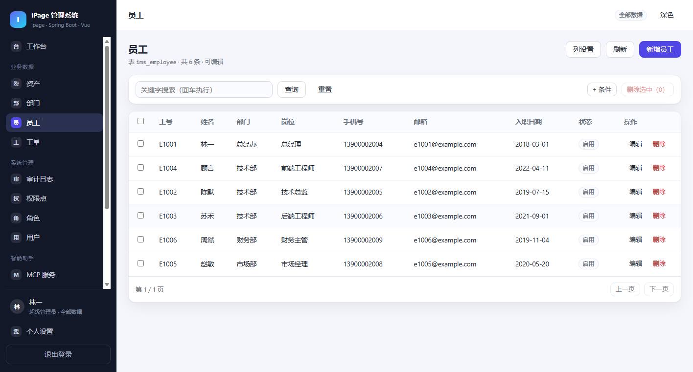
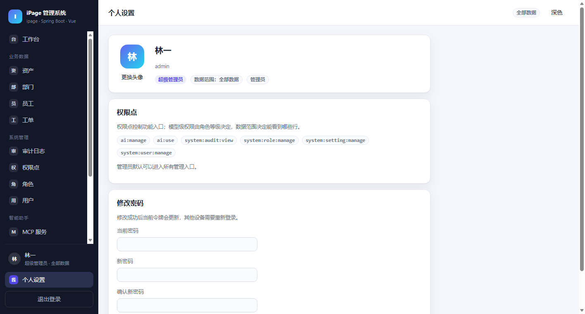

# iPage-IMS

基于 **ipage 注解驱动 SQL 引擎** 的信息管理系统：**注解即表结构，模型即页面**。
写一个模型类，自动得到建表、CRUD、权限、审计和前端页面——不写 Mapper、不写建表 SQL、不重复实现权限。

> 本项目同时是三个框架的「组合示范」：
> [iPage](https://github.com/rabbitc999/iPage) 负责 SQL 与表结构，
> [EmbedAiChat](https://github.com/rabbitc999/EmbedAiChat) 负责内嵌 AI 控制台，
> Spring Boot + Vue 3 负责把它们组装成一个完整产品。

## 系统预览

| 登录页 | 工作台 |
| --- | --- |
|  |  |
| **数据列表** | **个人设置** |
|  |  |

系统图像设置（站点名 / Logo / 登录页品牌图，管理员可改）见 [images/settings.png](images/settings.png)。

---

## 功能总览

| 能力 | 说明 |
| --- | --- |
| 模型驱动 | `@ModelClass` 声明表，启动时自动建表/补列，新模型零 SQL |
| 通用 CRUD | 一组 `/api/models/{key}` 接口服务所有模型，分页/搜索/过滤/排序/批量删除 |
| 权限管理 | RBAC 三层：**模型等级**（注解声明）× **角色权限点**（页面配置）× **数据范围**（全库/本部门/仅本人） |
| 自定义界面 | 前端按服务端 schema 渲染表格与表单；列显隐、每页条数按用户持久化 |
| 审计日志 | 所有写操作自动落库，工作台可查最近操作 |
| AI 助手（可选） | 内嵌 AI 对话 + 8 个 `ims_*` 工具直接维护数据，MCP 服务与 Skill 热装配，**AI 与页面走同一套权限** |
| 无状态认证 | HMAC 签名令牌，改密码/停用账号即时踢下线（令牌版本机制） |
| UUID 主键 | 全部表使用 UUID v4 字符串主键（引擎在插入时自动生成），不可枚举、可离线生成、合并安全 |
| 密码安全 | PBKDF2-HMAC-SHA256（210,000 次迭代）+ 每用户随机盐 + 登录时自动升级旧哈希 |
| 文件与图像 | `/api/files` 上传/下载/删除（内容落 BLOB，上限 10MB）；IMAGE 字段类型支持相对链接、绝对链接、`data:` 内联与二进制直存四种用法；管理员头像、站点 Logo / 登录页品牌图可视化配置 |

## 技术栈

- **后端**：Java 17 · Spring Boot 3.3 · iPage（内置源码）· EmbedAiChat（内置源码）
- **数据库**：默认 H2 文件库（开箱即跑），一键切 MySQL / PostgreSQL
- **前端**：Vue 3.5 · Vue Router 4 · Vite 6，无其他运行时依赖
- **AI**：OpenAI 兼容协议（默认 DeepSeek），MCP 走 stdio JSON-RPC

## 快速启动

### 1. 编译并启动后端（自带前端，单端口 8080）

```bash
# 需要 JDK 17+
./mvnw -pl server -am package -DskipTests
cd server && java -jar target/ims-server-1.0.0.jar
```

首次启动会自动建表并写入演示数据，看到这行就绪：

```
[ims] 演示数据完成：账号 admin/admin123、manager/manager123、staff/staff123
```

浏览器打开 <http://127.0.0.1:8080> 即可。

### 2. 前端开发模式（可选，热更新）

```bash
cd web && npm install && npm run dev   # http://127.0.0.1:5173，/api 代理到 8080
```

### 3. IDEA 里跑

项目自带 `.run/` 运行配置，打开工程后在右上角直接选：

- `ims-server`：启动后端（8080，同端口托管前端）
- `ims-web (dev)`：前端开发服务（5173，代理 /api）
- `ims-web (build)`：前端构建并同步进后端 static

## 演示账号

| 账号 | 密码 | 角色 | 数据范围 |
| --- | --- | --- | --- |
| `admin` | `admin123` | 超级管理员（等级 4） | 全部数据 |
| `manager` | `manager123` | 部门主管（等级 2） | 本部门 |
| `staff` | `staff123` | 普通员工（等级 1） | 仅本人创建 |

> 生产环境部署后请立即修改这三个密码。

## 开启 AI 助手

AI 默认关闭，配置环境变量后重启即可：

```bash
export IMS_AI_ENABLED=true
export IMS_AI_KEY=sk-xxxxxxxx          # 你的 API Key
export IMS_AI_BASE_URL=https://api.deepseek.com/v1   # 任意 OpenAI 兼容端点
export IMS_AI_MODEL=deepseek-chat
```

进入「智能助手」页：

- **对话**：直接说「帮我看看有多少资产」「把 E1001 的职位改成总经理」，AI 会调用 `ims_*` 工具完成操作，删除前会再次确认；
- **MCP**：填写命令（JSON 数组形式，如 `["python","mcp/demo_server.py"]`）即可挂接外部工具，仓库自带一个 Python 演示服务；
- **Skill**：内置 `ims-assistant` Skill 告诉模型如何安全地操作系统。

MCP/Skill 配置变更即时生效，无需重启。详细机制见 [docs/07-AI集成-MCP与Skill.md](docs/07-AI集成-MCP与Skill.md)。

## 切换数据库

```bash
# MySQL（先建库 ipage_ims）
java -jar ims-server.jar --spring.profiles.active=mysql \
     -DMYSQL_USER=root -DMYSQL_PASSWORD=你的密码
# 或环境变量 MYSQL_USER / MYSQL_PASSWORD

# PostgreSQL
java -jar ims-server.jar --spring.profiles.active=postgres \
     -DPG_USER=postgres -DPG_PASSWORD=你的密码
```

表结构由 iPage 自动创建（只建表、只补列，不改类型、不删列）。
> 注意：从自增整数主键的旧版本升级到 UUID 主键需要**重建数据库**（或自行迁移数据），iPage 不会修改已有列的类型。

## 常用环境变量

| 变量 | 默认值 | 说明 |
| --- | --- | --- |
| `IMS_SECRET` | 开发默认值 | 令牌签名密钥，**生产必改**（`openssl rand -base64 32`） |
| `IMS_AI_ENABLED` | `false` | 是否开启 AI 助手 |
| `IMS_AI_KEY` | 空 | AI 服务 API Key |
| `IMS_AI_BASE_URL` | DeepSeek | OpenAI 兼容端点 |
| `IMS_AI_MODEL` | `deepseek-chat` | 模型名 |
| `MYSQL_USER` / `MYSQL_PASSWORD` | `root` / `123456` | MySQL 凭据 |
| `PG_USER` / `PG_PASSWORD` | `postgres` / `123456` | PostgreSQL 凭据 |

## 目录结构

```
ipage-ims/
├── libs/
│   ├── ipage/             # iPage 引擎（Apache-2.0，源码内置）
│   └── embed-ai-chat/     # AI 控制台框架（AGPL-3.0，源码内置）
├── server/                # Spring Boot 服务端
│   ├── src/main/java/com/rabbitc/ims/
│   │   ├── model/         # ★ 业务模型都在这里，加新表从这里开始
│   │   ├── enums/         # 模型使用的枚举
│   │   ├── meta/          # 模型注册与 schema 下发
│   │   ├── service/       # 通用 CRUD、钩子、审计
│   │   ├── security/      # 登录、令牌、密码、拦截器
│   │   ├── ai/            # AI 引擎装配与 ims_* 工具
│   │   ├── seed/          # 建表 + 演示数据
│   │   └── web/           # REST 控制器
│   ├── mcp/demo_server.py # MCP 演示服务
│   └── src/main/resources/
├── web/                   # Vue 3 前端（schema 驱动）
│   └── src/
│       ├── views/         # 6 个页面
│       ├── components/    # AppLayout / DataForm
│       └── api/ stores/
├── clients/               # 独立客户端示例
│   └── cli/ims_cli.py     # 零依赖命令行客户端（登录/查询/增删改）
├── docs/                  # ★ 知识库文档
├── AGENTS.md              # ★ AI/开发者修改本系统的操作手册
├── THIRD-PARTY-NOTICES.md # 第三方许可证与合规说明
└── .run/                  # IDEA 运行配置
```

## 文档

| 文档 | 内容 |
| --- | --- |
| [AGENTS.md](AGENTS.md) | **AI 与开发者改造手册**：加一张表的完整步骤、必须遵守的约束、验收清单 |
| [docs/00-知识库索引.md](docs/00-知识库索引.md) | 全部知识库文档的索引 |
| [docs/01-架构总览.md](docs/01-架构总览.md) | 分层设计、请求生命周期、为什么这样设计 |
| [docs/02-数据模型.md](docs/02-数据模型.md) | 注解参考、字段类型语义、UUID 主键、加表步骤 |
| [docs/03-权限模型.md](docs/03-权限模型.md) | 等级 × 权限点 × 数据范围三层模型的完整语义 |
| [docs/04-后端开发指南.md](docs/04-后端开发指南.md) | 服务层、钩子、事务、错误处理约定 |
| [docs/05-API参考.md](docs/05-API参考.md) | 全部 REST 接口与参数 |
| [docs/06-前端开发指南.md](docs/06-前端开发指南.md) | schema 驱动渲染、自定义页面、主题 |
| [docs/07-AI集成-MCP与Skill.md](docs/07-AI集成-MCP与Skill.md) | AI 架构、工具白名单、MCP/Skill 管理 |
| [docs/08-部署运维.md](docs/08-部署运维.md) | 打包、切库、安全清单、备份 |
| [docs/09-常见问题.md](docs/09-常见问题.md) | 启动失败、权限 403、乱码等排查 |
| [docs/10-客户端开发指南.md](docs/10-客户端开发指南.md) | **独立客户端**（小程序/桌面/移动/命令行）如何对接同一套接口 |

## 客户端开发

`web/` 是随服务端一起发布的管理端。如果还需要一个**独立客户端**（毕业设计常见的"员工小程序"、
桌面工具、安卓 App），不需要碰后端一行代码——它对接的是同一套 `/api` 接口，
权限、数据范围、审计完全一致：

- 选型对比、请求层封装、schema 驱动页面、可运行的小程序示例代码 →
  [docs/10-客户端开发指南.md](docs/10-客户端开发指南.md)
- 接口清单 → [docs/05-API参考.md](docs/05-API参考.md)

要点只有三条：**令牌走 `Authorization: Bearer`**、**字段从 schema 读不要写死**、
**主键是 UUID 字符串不要转 Number**。

仓库里带了一个可直接运行的参考客户端（零依赖，可当演示数据工具）：

```bash
cd clients/cli
python ims_cli.py login --user admin --password admin123
python ims_cli.py list employee --kw 苏
```

## 许可证

本项目原创代码（`server/`、`web/`、`docs/`）以 **MIT** 许可证发布，见 [LICENSE](LICENSE)。

内置的第三方模块各自保留原始许可证：

- `libs/ipage` — [Apache-2.0](https://github.com/rabbitc999/iPage)（宽松，与 MIT 兼容）
- `libs/embed-ai-chat` — [AGPL-3.0](https://github.com/rabbitc999/EmbedAiChat)（**强著佐权**）

⚠️ 只要发行包里包含 `embed-ai-chat`，整个发行包对外分发时需遵守 AGPL-3.0 并提供完整源码。
需要纯 MIT、可闭源商用的发行版，请按 [THIRD-PARTY-NOTICES.md](THIRD-PARTY-NOTICES.md) 的
「合规路径」移除该模块或将其拆为独立进程。

## 致谢

- [iPage](https://github.com/rabbitc999/iPage) —— 注解驱动 SQL 引擎
- [EmbedAiChat](https://github.com/rabbitc999/EmbedAiChat) —— 可嵌入宿主的 AI 控制台框架
- [Spring Boot](https://spring.io/projects/spring-boot) · [Vue](https://vuejs.org/) · [Vite](https://vitejs.dev/)
